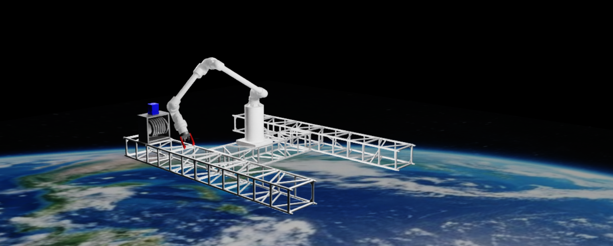
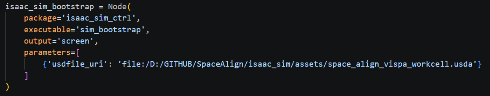
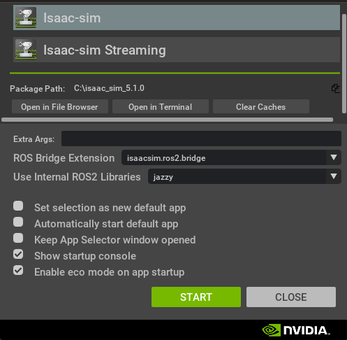

# SpaceAlign



## Prerequisite
Prerequisite:
* Windows 11 with WSL2 Ubuntu 24.04 (noble)

  or
  
* Ubuntu 24.04 (noble)
```sh
wsl  --install Ubuntu-24.04 --name SpaceAlign
```
(name is optional, but usefull if several distro are installed)

### Install Isaac sim v5.1.0
Install NVIDIA isaac sim following this guide https://docs.isaacsim.omniverse.nvidia.com/5.1.0/installation/index.html. 

## Installation inside Ubuntu


#### Setting up
Clone the GIT repository

Run the setup shell script. This will install ROS2 Jazzy Jalisco and some extra packages that are needed:
```sh
./setup.sh
```
Source ROS2. For convenience this can be added to .bashrc
```sh
source /opt/ros/jazzy/setup.bash
```
Open the launch file in an editor:
```sh
gedit ~/SpaceAlign/SpaceAlign-ros_ws/src/launch_configs/launch/robot_system.launch.py
```
Locate the definition of the `isaac_sim_bootstrap` node and changes the `usdfile_uri` parameter to reflect your system. For your convenience you can search for `<YOUR-PATH-TO>` to do a search and replace. 



Build the SpaceAlign workspace. Note that one package will report a warning - but that's OK.
```sh
cd ~/SpaceAlign/SpaceAlign-ros_ws 
rosdep install -r --from-paths . --ignore-src --rosdistro $ROS_DISTRO
source /opt/ros/jazzy/setup.bash
colcon build
```
Source the SpaceAlign workspace (for convenience this can also be added to .bashrc):
```sh
source ~/SpaceAlign/SpaceAlign-ros_ws/install/local_setup.bash
```

---
## Setup IsaacSim
IsaacSim should be launched with jazzy ros2 bridge. This is easiest done by running the selector script and in the popup window choose `isaacsim.ros2.bridge` as the ROS Bridge Extension and `jazzy` as the Internal ROS2 libraries.



Inside IsaacSim the ROS2 Simulation Control extension should be enabled (Window -> Extensions, search for `ros`, and toggle the enabled button)

**Note!** Do not source /opt/ros/jazzy/setup.bash in the terminal used to launch isaac sim. Give rise to issues when enabling the extention ros2_sim_control


### Setup IsaacSim when running on Windows with WSL

ATTENTION! The following asumes that the `ROS_DOMAIN_ID` is set to 0. If ROS_DOMAIN_ID is set to something else all port numbers should be changed!

Inside WSL run the following command to get the IP address of WSL:
```sh
hostname -I
```
On Windows open Powershell as Admin and set the network interface to private (the interface alias should be the name that matches the physical adapter that haves network access - not the WSL adapter):
```sh
Set-NetConnectionProfile -InterfaceAlias Ethernet -NetworkCategory "Private"
```
In Powershell run the following command to retrieve the IPv4 address of the Windows host (here it is the IP address for the WSL adapter you shall find!):
```sh
ipconfig /all
```
Set the variables in Powershell (Admin) according to the respective IP addresses:
```sh
$Windows_IP = "<WINDOWS_IP>"
$WSL2_IP = "<WSL2_IP>"
```
and setup port forwarding in Powershell (Admin) for the specific ports used by default DDS (FastDDS) in ROS:
```sh
netsh interface portproxy add v4tov4 listenport=7400 listenaddress=$Windows_IP connectport=7400 connectaddress=$WSL2_IP
netsh interface portproxy add v4tov4 listenport=7410 listenaddress=$Windows_IP connectport=7410 connectaddress=$WSL2_IP
netsh interface portproxy add v4tov4 listenport=9387 listenaddress=$Windows_IP connectport=9387 connectaddress=$WSL2_IP
```
In the Windows Firewall add both a inbound and outbound rule that allows UDP communication at the port range 7400-7500

---
## Running SpaceAlign
Run the following command. (sometimes this command _hangs_, often first time after boot, but running the command `ros2 service list` in another terminal will push it forward)
```sh
ros2 launch launch_configs robot_system.launch.py
```

### Test SpaceAlign
To test everything, run following command in a new terminal (the robot in IsaacSim should make some movements):
```sh
ros2 run isaac_sim_ctrl test_srvs
```
---
## Test SpaceAlign in sequence
To test the SpaceAlign multiple times use the `start_system.sh`. 
**Note!** You need to update paths according to your installation. Line 20-23.

```sh
ISAAC_SIM="$HOME/isaacsim/isaac-sim.sh"
ROS_WS="$HOME/SpaceAlign/SpaceAlign-ros_ws"
RESULT_XML="$HOME/test_linNorm.xml"
RESULT_DIR="$HOME/Test_SPA_test/lin_Nominal"
```
This test will produce logs and error files that can be examined with the tool in `SpaceAlign/utils/mal_log_plot.py`


---
## Usefull commands (WSL)
Start wsl distro: 
```sh
wsl -d SpaceAlign
```
Inside Ubuntu, see the WSL distro name:
```sh
echo $WSL_DISTRO_NAME
```


 
